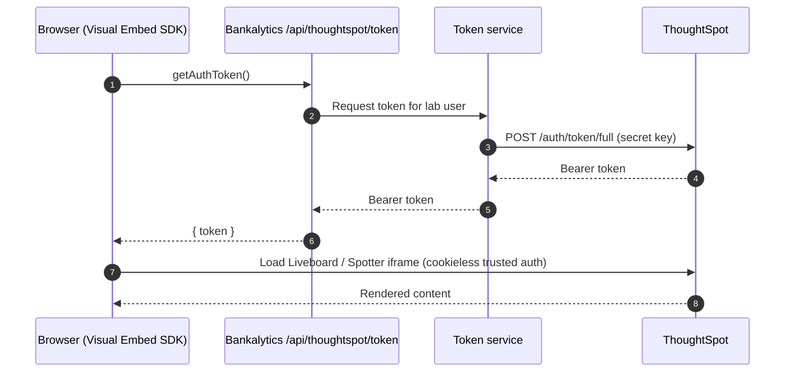
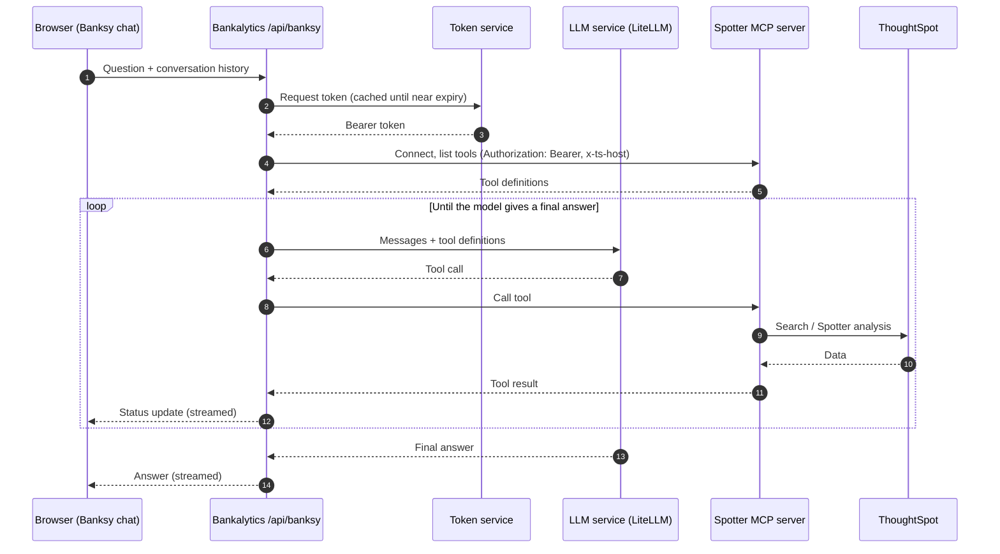

# Bankalytics Architecture

Bankalytics is a Next.js banking analytics portal for ThoughtSpot hands-on labs. It shows ThoughtSpot content in two ways:

- **Embedded analytics:** Liveboards and Spotter are embedded in the page with the ThoughtSpot Visual Embed SDK.
- **Banksy:** a chat assistant. An LLM answers questions by calling ThoughtSpot tools through the Spotter MCP server.

Both paths authenticate to ThoughtSpot with tokens issued by the token service, `ts-embed-lab-token-service`. The app never holds the ThoughtSpot secret key.

## Components

| Component | What it does | Where it runs |
| --- | --- | --- |
| **Bankalytics app** | The Next.js UI and its server-side API routes. It embeds ThoughtSpot content, gets tokens from the token service, and runs the Banksy agent loop. | Lab attendee's machine (`npm run dev`) |
| **Token service** (`ts-embed-lab-token-service`) | Checks that a caller is a valid lab user, then mints a ThoughtSpot trusted-auth token for them. It is the only component that holds the ThoughtSpot secret key. | Shared lab service |
| **ThoughtSpot** | The analytics platform. It hosts the banking data model, Liveboards, and Spotter, and it issues tokens to the token service. | ThoughtSpot Cloud instance |
| **Spotter MCP server** | Exposes ThoughtSpot search and Spotter analysis as Model Context Protocol (MCP) tools. Calls it receives run against ThoughtSpot as the user who owns the bearer token. | `agent.thoughtspot.app` (hosted by ThoughtSpot) |
| **LLM service** | A LiteLLM proxy that fronts the model behind Banksy (Claude). The app sends it messages and tool definitions in the Anthropic Messages format. | Shared lab service |

## System overview

```mermaid
flowchart LR
    user(["Lab attendee<br/>(browser)"])

    subgraph app["Bankalytics app (Next.js)"]
        ui["UI pages<br/>Analytics, Bankalytics AI, Banksy chat"]
        tokenRoute["/api/thoughtspot/token"]
        banksyRoute["/api/banksy<br/>agent loop"]
    end

    tokenSvc["ts-embed-lab-token-service"]
    ts@{ img: "https://raw.githubusercontent.com/thoughtspot/tse-hol-banking-analytics/main/public/ts.png", label: "ThoughtSpot", pos: "b", w: 60, h: 60, constraint: "on" }
    mcp["Spotter MCP server"]
    llm["LLM service<br/>(LiteLLM → Claude)"]

    user --> ui
    ui -- "Visual Embed SDK iframe" --> ts
    ui -- "getAuthToken" --> tokenRoute
    ui -- "chat question (streamed reply)" --> banksyRoute

    tokenRoute -- "request token" --> tokenSvc
    banksyRoute -- "request token" --> tokenSvc
    tokenSvc -- "trusted auth<br/>(secret key)" --> ts

    banksyRoute -- "messages + tools" --> llm
    banksyRoute -- "MCP tool calls<br/>(bearer token)" --> mcp
    mcp -- "REST / Spotter APIs" --> ts
```

## Flows

### Authentication

1. The Bankalytics server asks the token service for a ThoughtSpot token for the lab user.
2. The token service checks that the user is valid. It then calls ThoughtSpot's trusted-auth token endpoint (`/api/rest/2.0/auth/token/full`) with the secret key.
3. ThoughtSpot returns a short-lived bearer token. The token service passes it back to the app.

Tokens expire, so the app asks for a new one when the current one is close to expiring. The Visual Embed SDK requests a new token through `getAuthToken` each time it needs one.

### Embedded analytics



The SDK uses `AuthType.TrustedAuthTokenCookieless`, so ThoughtSpot gets the token directly and no third-party cookies are needed.

### Banksy chat (LLM + MCP)



The agent loop runs on the server. The browser talks only to `/api/banksy`, and never to the LLM service or the MCP server directly. Spotter analysis can take minutes, so the route streams status updates while tools run.

## Trust boundaries and secrets

| Secret | Held by | Never reaches |
| --- | --- | --- |
| ThoughtSpot secret key | Token service only | Bankalytics app, browser |
| ThoughtSpot bearer token | Bankalytics server; the browser gets embed tokens only | Logs |
| LLM API key | Bankalytics server | Browser |

- Everything that needs a credential goes through a server-side API route. The only ThoughtSpot setting the browser gets is the host URL (`NEXT_PUBLIC_THOUGHTSPOT_HOST`).
- Bankalytics API routes accept only same-origin requests, are rate limited, and send `Cache-Control: no-store` on token responses.
- The app reaches the token service, LLM service, and MCP server over HTTPS.

## Configuration

The Bankalytics app reads these settings from `.env.local`. See `.env.example` for a template.

| Variable | Used for |
| --- | --- |
| `NEXT_PUBLIC_THOUGHTSPOT_HOST` | ThoughtSpot instance URL (browser and server) |
| `TS_USERNAME` | Lab user to request tokens for |
| `TOKEN_SERVICE_URL` | Base URL of `ts-embed-lab-token-service` |
| `TS_MCP_URL` | Spotter MCP server endpoint |
| `LITELLM_URL`, `LITELLM_API_KEY`, `LITELLM_MODEL`, `LITELLM_MAX_TOKENS` | LLM service connection and model settings |

`TS_SECRET_KEY` moves from the app into the token service's configuration.
